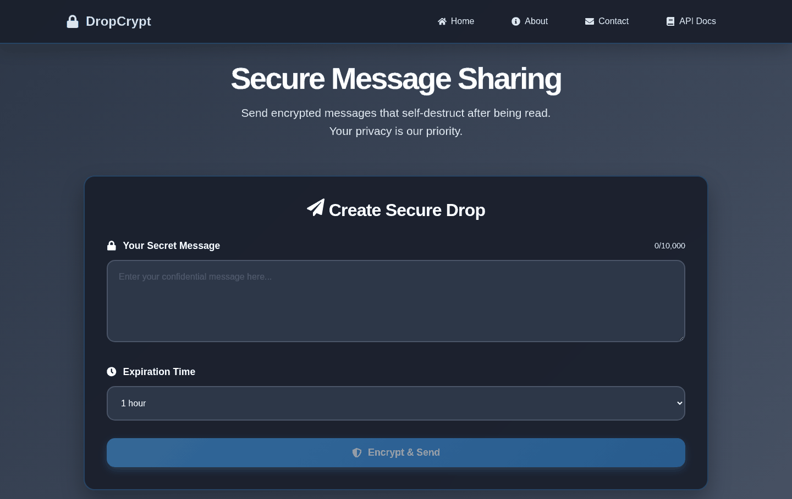
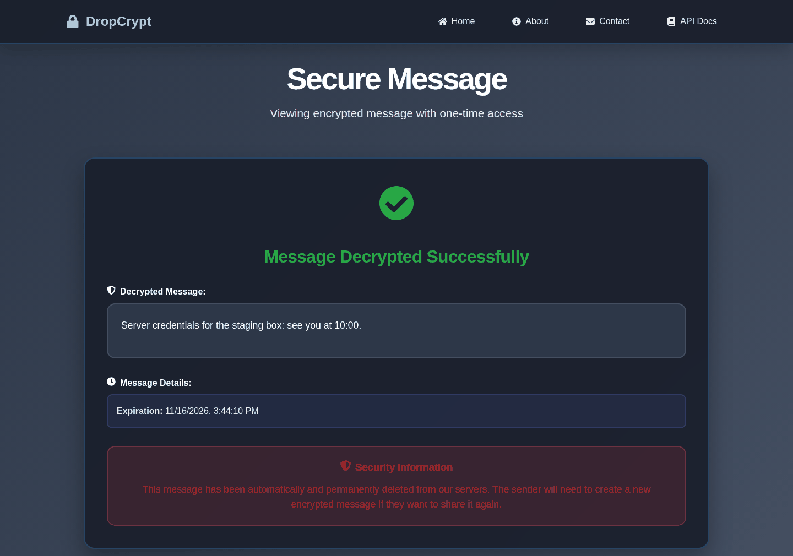
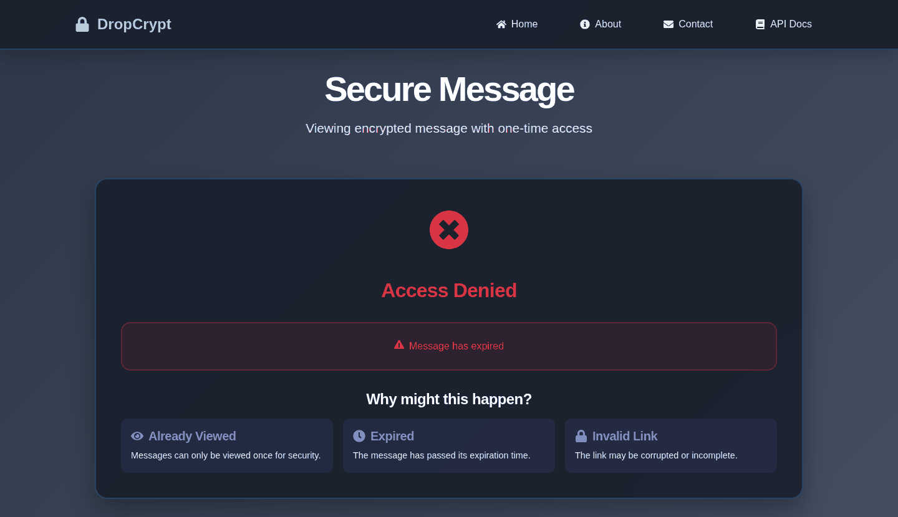

<div align="center">

# DropCrypt

**Share a secret through a link that works once.** A message is stored under a random access token, can be read a
single time, and is gone after it has been viewed or has expired.


</div>

---

## About

DropCrypt is a small self-hosted service for passing a password, a key or a short note to someone without leaving it
in a chat history. You write the message, pick an expiry time and get a link. The first person to open the link sees
the message; every later visit, and any visit after the expiry time, gets an error.

It is a Symfony JSON API with a React single-page app in front, served together by nginx.

## Status

> **Work in progress: do not put real secrets into it yet.**
>
> The design goal is end-to-end encryption: the browser encrypts the message and the key travels only inside the
> link, so the server never sees plaintext. The backend is already built for that, it stores whatever ciphertext the
> client sends. **The React client does not encrypt yet** (encryption was moved out of the backend in
> [`4124c89`](https://github.com/blackburn2601/dropcrypt/commit/4124c89) in preparation for it), so today the
> content is stored exactly as typed. I checked this in the running stack: the `message` table contains the plaintext.
>
> The texts in the UI (About page, "End-to-End Encryption" cards, API docs) still describe the target design, not the
> current behaviour. See [Known issues](#known-issues).

What works and was checked end to end: one-time viewing, expiry, random 256-bit access tokens, the API and the
Docker setup.

## Screenshots

|  |  |
|:--:|:--:|
|  |  |
| **Create** — write a message, choose how long the link stays valid | **Read once** — the recipient sees the message, which is then marked as viewed |

<div align="center">

<br><em><strong>Gone</strong> — a second visit, or a visit after the expiry time, gets an error instead of the message</em>
</div>

## How it works

```
Sender                         Server                          Recipient
  │  POST /api/messages/create    │                                │
  │  {content, expiresIn}  ─────▶ │  store content + random        │
  │                               │  256-bit access token          │
  │  ◀───────── accessToken       │                                │
  │                               │                                │
  │  sends link /view/<token> ──────────────────────────────────▶  │
  │                               │  GET /api/messages/view/<token>│
  │                               │ ◀───────────────────────────── │
  │                               │  200 + content, marks viewed   │
  │                               │  ───────────────────────────▶  │
  │                               │  next request: 410 Gone        │
```

- **Access token**: 32 random bytes from `random_bytes()`, hex encoded (64 characters), looked up by exact match.
- **One-time read**: the first successful view sets `is_viewed`; later requests get `410 Gone`.
- **Expiry**: the sender chooses a duration (for example `1 hour`); an expired message is deleted when it is requested
  and answers `410 Gone`.
- **Limits**: content up to 15 000 characters in the database column; the UI limits input to 10 000.

## API

| Method | Path | Body / result |
|---|---|---|
| `POST` | `/api/messages/create` | `{"content": "...", "expiresIn": "1 hour"}` returns `{"accessToken", "expiresAt"}` |
| `GET` | `/api/messages/view/{accessToken}` | `200 {"content", "expiresAt"}` once, then `410`; unknown token `404` |

```bash
curl -X POST http://localhost/api/messages/create \
  -H 'Content-Type: application/json' \
  -d '{"content":"hello","expiresIn":"1 hour"}'
```

Result of a real run against this stack: the first `GET` of the returned token answered `200`, the second `410`
(`{"error":"Message has already been viewed"}`), and a token that never existed `404`.

## Tech stack

| | |
|---|---|
| Backend | PHP 8.2 · Symfony 6.4 · Doctrine ORM 2 · PHP-FPM · NelmioCorsBundle |
| Frontend | React 19 · React Router 7 · Create React App |
| Data | PostgreSQL 15 |
| Serving | nginx (static SPA + `/api` to PHP-FPM) |
| Packaging | Docker Compose (nginx, php, postgres and a one-shot frontend build job) |

## Quick start

Requires Docker with Compose.

```bash
git clone git@github.com:blackburn2601/dropcrypt.git && cd dropcrypt

cp backend/.env.example backend/.env
sed -i "s|^APP_SECRET=.*|APP_SECRET=$(openssl rand -hex 32)|" backend/.env

docker compose up -d --build
```

Open <http://localhost>. The first start installs the frontend dependencies and builds the app, which takes a few
minutes; database migrations run automatically when the PHP container starts. All services report healthy
afterwards.

`setup.sh` automates the same steps (environment file, keys, containers). I did not run it for this review; the
commands above are the ones I verified.

## Project layout

```
backend/
├── src/Controller/MessageController.php   create + view endpoints
├── src/Entity/Message.php                 content, access token, expiry, viewed flag
├── src/Service/EncryptionService.php      AES-256-GCM helper and access-token generator
├── src/Security/TokenAuthenticator.php
├── migrations/                            Doctrine migrations
└── docker/php/                            Dockerfile + entrypoint (waits for DB, migrates)
frontend/src/                              App (create form), ViewMessage, About, Documentation, Contact
docker/nginx/default.conf                  SPA + /api routing
docker-compose.yml                         nginx, php, postgres, frontend build job
setup.sh                                   optional bootstrap script
```

## Known issues

I reviewed the code and ran the stack before writing this README. These are the open problems, most important first:

1. **Content is stored in plaintext.** No client-side encryption exists yet, see [Status](#status).
   `EncryptionService` (AES-256-GCM) is still in the backend, but only its access-token generator is used.
2. **The generated link ends in `?token=undefined`.** The viewer page expects an encryption key in the link, which
   the create endpoint does not return because nothing generates one yet.
3. **UI and API-docs copy overstates the security.** "Zero Knowledge", "End-to-End Encryption" and "AES-256"
   describe the intended design. The documentation page still shows the base URL `https://api.dropcrypt.org`.
4. **Settings that nothing reads.** `MESSAGE_ENCRYPTION_KEY`, `MESSAGE_DEFAULT_EXPIRY`, `MESSAGE_MAX_LENGTH` and
   `RATE_LIMIT_PER_MINUTE` appear in the example environment, but no code uses them. There is **no rate limiting**.
5. **No automated tests.** `backend/tests` contains only the PHPUnit bootstrap; there is no CI.
6. **Development defaults.** `APP_ENV=dev` and the database password `dropcrypt` are meant for local use only.

## License

MIT
